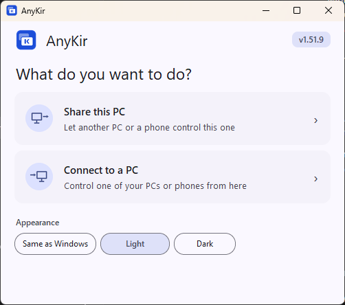
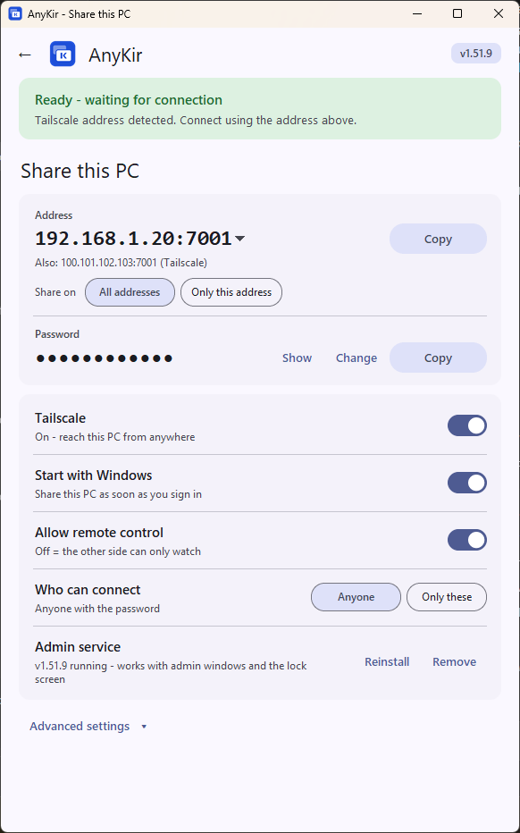
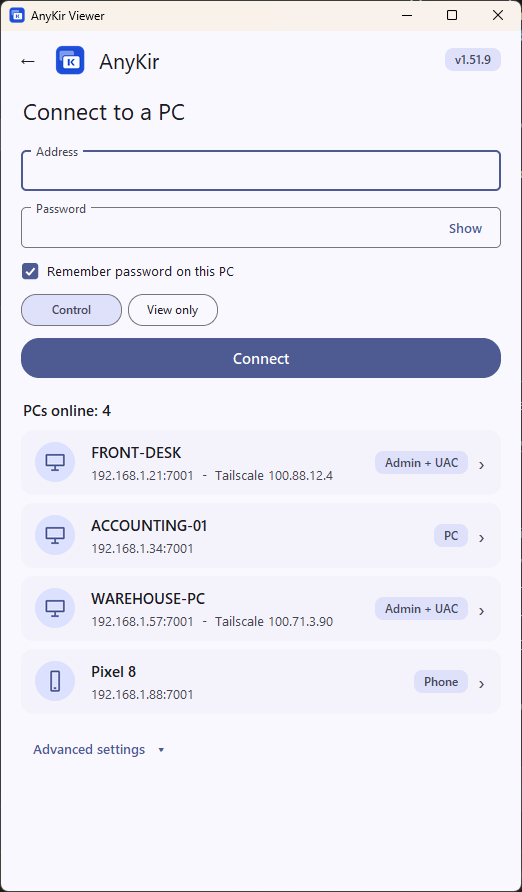
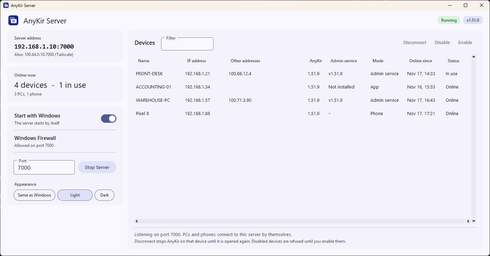

# AnyKir

AnyKir is a small remote desktop tool I built for controlling the PCs at work (and from home) without
paying for a license or making an account anywhere. It's one Windows exe plus an Android app.

- **Share this PC** on the computer you want to control.
- **Connect to a PC** on the computer (or phone) you're sitting at.

Everything between the two is encrypted with AES-256-GCM, and the key comes from the PC's password, so
nothing in the middle can read it, not even AnyKir Server.

## Screenshots

<p>
  
</p>

**Share this PC** (the PC you want to control) and **Connect to a PC** (the one you're sitting at):

<p>
  
  
</p>

**AnyKir Server**, which lists every PC and phone that's online:



The PC names and addresses in these are made up.

## What's in here

| Part | What it does |
| --- | --- |
| `anykir.py` | The desktop app. Starts the Share or Connect screen. |
| `host.py` | Sharing side: screen capture, sending changed parts of the screen as JPEG, mouse/keyboard input, clipboard, files. |
| `viewer.py` | Connecting side: draws the remote screen and sends your input back. |
| `common.py` | The protocol: handshake, key derivation (scrypt), encrypted channel. |
| `hub.py`, `server.py` | AnyKir Server. PCs dial out to it, so you can reach them even when you can't open ports. It also shows which PCs are online. |
| `windows_service.py`, `service_setup.py` | Optional admin service, so you can click UAC prompts and unlock the PC from the sign-in screen. |
| `updater.py`, `publish.py` | Signed auto-updates. PCs and phones only install releases signed with my key. |
| `ui.py`, `logo.py` | The look of the Tkinter windows and the icon. |
| `mobile/` | The Android app (Flutter + a bit of Kotlin). |

## Running it

You'll need Python 3.12 on Windows.

```
pip install -r requirements.txt
python anykir.py
```

Building the exe:

```
build.bat
```

This puts `AnyKir.exe` in `dist\`. Copy it to both PCs and run it. Windows Firewall will ask the first
time; allow it.

## Connecting

On the PC you want to control, open **Share this PC**. It shows an address and a password. On the other PC,
open **Connect to a PC**, type them in and hit Connect.

How the two PCs find each other:

- **Same network:** just use the local address, like `192.168.1.20:7001`.
- **Tailscale:** put both PCs on the same Tailscale account and use the `100.x.x.x` address. This is what
  I use from home.
- **AnyKir Server:** run `server.py` (or `AnyKirServer.exe`) on one always-on machine. Shared PCs connect to
  it on port 7000 and show up in the "PCs online" list.
- **Port forwarding:** forward TCP 7001 to the PC and use your public IP.

The default server and update addresses are my office ones. Change them in `hub.py` (`DEFAULT_HUBS`,
`VIEWER_SERVERS`), `updater.py` (`DEFAULT_SOURCES`) and `mobile/lib/updates.dart` before you use this
anywhere else.

## Admin windows and the lock screen

By default, Windows won't let AnyKir click on admin windows, UAC prompts or the lock screen. To get around
that, go to **Share this PC > Advanced settings > Install admin service**. It runs as a Windows service,
starts with Windows, and lets you press Ctrl+Alt+Del and type the Windows password from the other side.

From the command line: `AnyKir.exe --install-service` / `--uninstall-service`.

## Android app

The phone app in `mobile/` can control any shared PC, and it can also share the phone itself so a PC can
control it (screen through Android's screen capture, taps and typing through an accessibility service you
turn on once in Settings).

To build it you need Flutter, JDK 17 and the Android SDK:

```
cd mobile
flutter build apk --release
```

## Updates

Every copy checks for a new version every few minutes and installs it when nobody is connected. To ship a
new version:

```
python publish.py 1.2.0
```

That builds the exe, the server and the APK, signs them, and serves them on port 7002. Releases are signed
with an Ed25519 key kept in `%USERPROFILE%\.anykir-signing\` (it's not in this repo). If you fork this, make
your own key and put its public half in `PUBLIC_KEY` in `updater.py`.

## Tests

```
python -m pytest test_service.py
cd mobile && flutter test
```

## Known limits

- No audio, and only text goes through the clipboard.
- File transfer only works through the normal app, not the admin service.
- Connecting a PC to itself doesn't work.
- Windows only on the desktop side, Android only on mobile.
